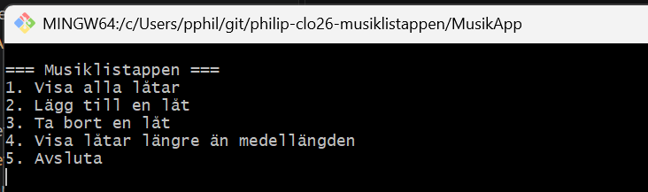

# Musiklistappen — Philip Ekbrand

> **Instruktion till dig:** den här filen är *din* README. Ersätt all text i hakparenteser med din egen, och ta bort den här rutan när du är klar. Uppgiften och kraven står i [`UPPGIFT.md`](UPPGIFT.md), och inlämningen beskrivs i [`INLAMNING.md`](INLAMNING.md).

---

## Vad appen gör

super enkel app som läser in en michael jackson databas.
man kan se alla låtar, lägga till och ta bort låtar.
Man kan ockå se dem låtarna som är övermedellängden.

## Så kör du den

```bash
git clone https://github.com/pekbrand/philip-clo26-musiklistappen/
cd philip-clo26-musiklistappen/MusikApp
dotnet run
```

 `musik.db` måste ligga i mappen `MusikApp/` annars hittars inte databasen

## Så ser huvudmenyn ut


---

## Mina designval (VG)

*Fyll i det här avsnittet om du siktar på VG. Annars kan du ta bort det.*

1. **Hur designade du din databas? Varför valde du just den strukturen?**

   jag valde mig att använda samma struktur som vi gjorde i förra uppgiften, tyckte det var kul att få använda den i praktiken.

2. **Vilket SQL-krav valde du (JOIN eller subquery) och varför passade det din app?**

   jag valde att använda subquery eftersom jag redan hade fungerade kod för att skriva ut alla låtarna i terminalen.
   Så det enda jag behövde gör var att skriva en ny sql.
   Sen subquery är roligt att använa och det är väldigt bra när man jobbar med stor mängd data för att filtrera ner den så ett smidigt sätt.

3. **Vad skulle du gjort annorlunda om du byggde om den från scratch?**

   hmm, jag kanske faktiskt hade byggt en helt ny databas, nu skrev jag ju all kod utifrån databasen istället för att
   funderar på appen och bygga databasen utfrån den istället
